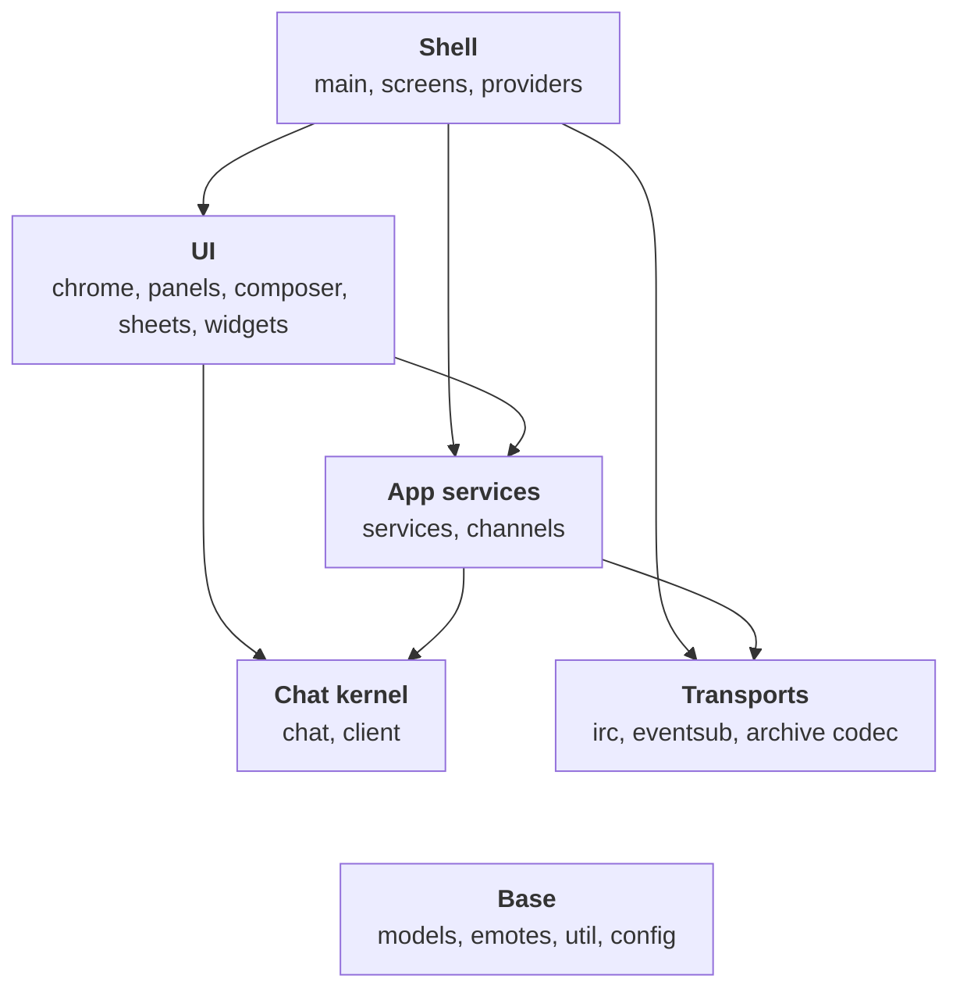
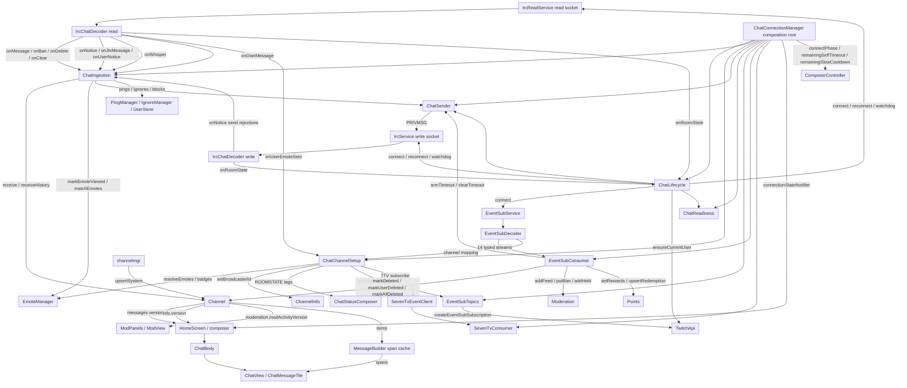
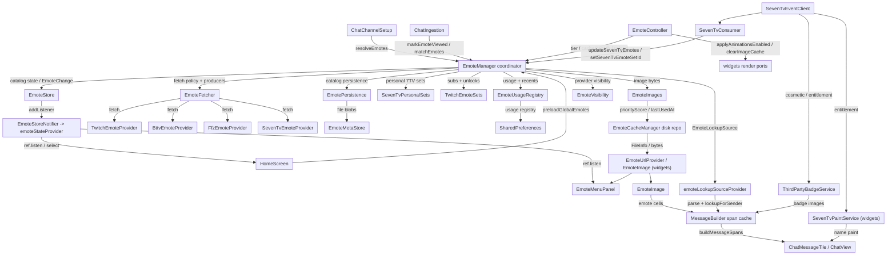
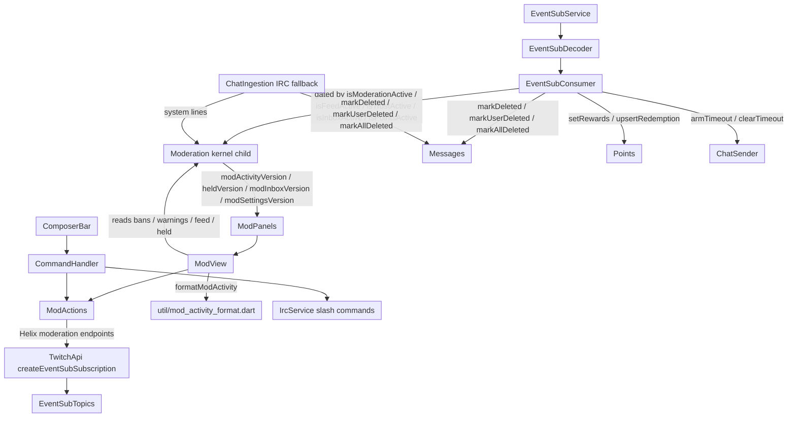
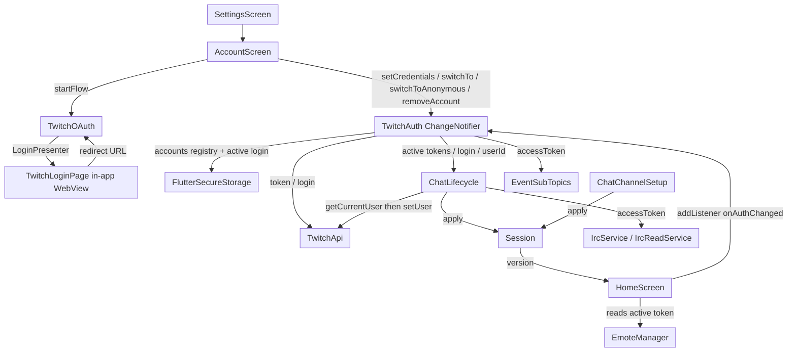
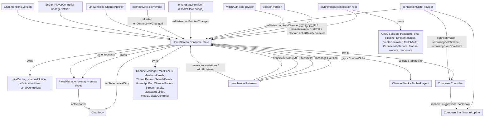
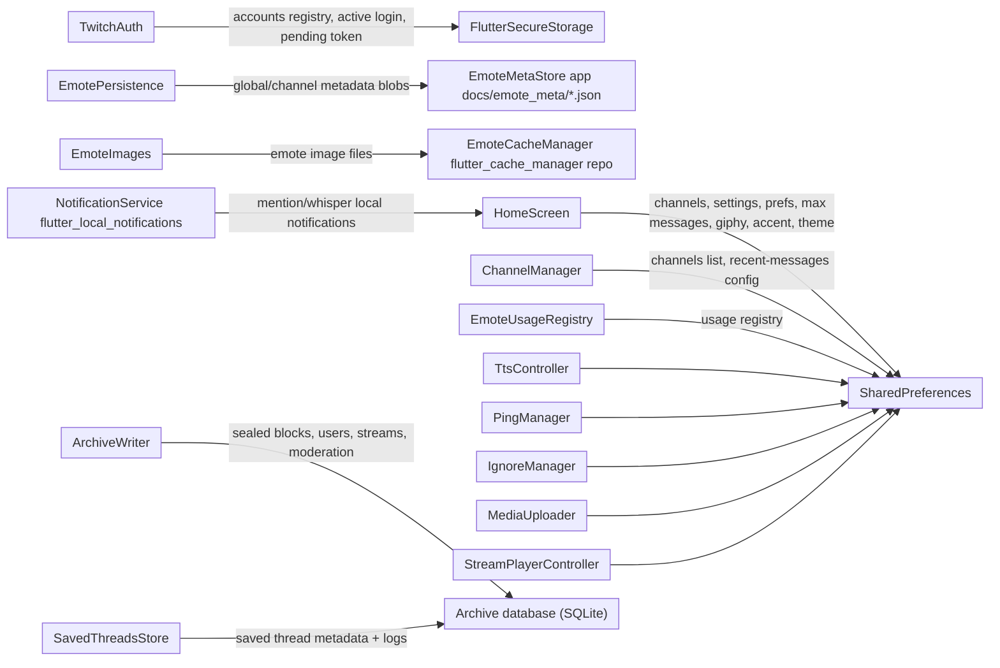

# ermchat architecture

ermchat is a single-package Flutter Twitch chat viewer. `lib/providers` is the composition root: app-scope Riverpod providers construct and dispose the chat kernel (`Chat`), `Session`, the transports, the chat pipeline (`ChatConnectionManager`), the feature owners (`TwitchAuth`, `AnalyticsService`, `ModActions`, `CommandHandler`, `BroadcastWidgets`, and the rest), and the read-state the pipeline consumes. `HomeScreen` is a consumer: it reads providers, forwards UI signals to the presentation owners it still keeps (composer, panels, chrome, message builder, media upload), and drives view-only caches with typed notifiers. Dependencies point inward and downward: raw transports feed decoders, decoders feed pipeline consumers, consumers mutate the `lib/chat/` kernel, and the UI reads kernel state and observes provider-owned objects through `ref.listen`/`ref.watch` or the sanctioned `Listenable` builders. There is no global event bus; each owner exposes a typed notifier or change stream.

Everything below is based on imports, provider wiring in `lib/providers/`, and the `attach()`/`Listenable` registrations in the source. Arrows mean "depends on / feeds". Provider-owned owners are still wired through constructors, but the construction site is a provider, not `HomeScreen`.

## Top-level overview

`lib/` groups into six layers by folder. Arrows mean "imports". Every layer also imports Base, so those edges are left out. The rules for these layers live in `docs/ARCHITECTURE_RULES.md`.

## Known exceptions

The sanctioned departures from the rules, each recorded in `docs/DECISIONS.md`. Keep this list current: add a row when an exception is sanctioned, delete it when the code stops needing it.

| Exception | Where | Why |
|---|---|---|
| widgets import providers | `emote_menu_panel.dart`, `chat_rows.dart` | The emote menu reads the emote and app providers; `ChatRows` reads `chatNoticeProvider` for the copy notice. |
| channels import UI | `channel_manager.dart` | `ChannelManager` takes `ComposerController`, `ThreadPanels`, and `BroadcastWidgets` as constructor deps; `lib/channels` straddles pipeline and UI until its pass. |
| eventsub topics import services and kernel | `eventsub/topics.dart` | `EventSubTopics` is the client surface, not a leaf: it holds `TwitchApi`, `TwitchAuth`, `Chat`, and `Session` to create subscriptions. |
| UI import cycles | panels and composer, widgets and composer | `ComposerBar` opens the mod and search panels and the panels write into `ComposerController`; `ChatBody` hosts `ComposerBar`, which builds on `MessageInput` and `PanelManager`. All one layer. |
| UI notifies the kernel | `home_screen.dart` | `ChannelInfo.touch()` (notify only) after settings that change tile content. |
| HomeScreen owns UI owners | `home_screen.dart` | Composer, panels, chrome, message builder, media upload, panel manager, link whitelist and channel notifier still construct there and use `host: this` ports. |
| `MessageBuilder` stamps tokens | `message_builder.dart` | Memoizes the first-render emote parse onto `TwitchMessage.emoteTokens` for restored threads; one idempotent assignment. |

## Chat data pipeline

`ChatReadiness` is a pure state holder answering `pipeUp`, `isChannelReady`, and join-failure queries from injected connection predicates. `ChatSender` owns macros, slash dispatch, the duplicate-text bypass, and the self-timeout/slow-mode gates. `ChatStatusComposer` merges ROOMSTATE tags with periodic Helix stream info into `ChannelInfo.status`.

## Emotes

`EmoteManager` is the coordinator and single doorway for the emote area, not a daemon: it holds no catalog caches directly. It feeds fetches into `EmoteStore` (plain Dart catalog state: per-scope provider lists, 7TV identity and live sets, merged lookup caches, id index) and coordinates the owners: `EmoteUsageRegistry` (usage plus image eviction policy), `SevenTvPersonalSets` (viewer and foreign personal sets), `TwitchEmoteSets` (subs plus account unlocks), `EmotePersistence` (global/channel catalog blobs), `EmoteImages` (image bytes), and `EmoteVisibility` (provider toggles). `EmoteFetcher` holds the fetch policy and the per-provider producers. `EmoteStore` emits typed `EmoteChange`s; the `EmoteStoreNotifier` bridges that listener stream to `emoteStateProvider`, so widgets observe with `ref.listen`/`select`. The store also owns the canonical emote pool: every served lookup, picker tab, and baked message token holds `identical()` instances per id. `MessageBuilder` reads only the narrow `EmoteLookupSource` (one-shot parse, sender lookup, image owner) exposed by `emoteLookupSourceProvider`. Emote tokens bake onto the message at ingest and freeze; a row baked before its global and channel catalogs landed is flagged `emotesPartial` and only gains emotes on later full commits; live surfaces (typing, picker, menus) read the current mixer on every change. Render-side code (`EmoteUrlProvider` and its animation completer, `EmoteImage`, `SevenTvPaintService`, and decode) lives in `lib/widgets`, and `EmoteController` reaches it through injected ports.

## Moderation

`EventSubTopics` owns the seven topic families (`channel.moderate`, AutoMod, feed, inbox, trust, points, widgets), the per-family active/skip sets, and the account-scoped 403 skip sets. `EventSubConsumer` applies the decoded events; while `channel.moderate` v2 is active it suppresses the duplicate IRC moderation echoes in `ChatIngestion`.

## Auth and accounts

`TwitchAuth` is the only owner of credentials (secure-storage registry plus the active account). `Session` is identity only (login/userId plus `version`); it lives outside the kernel, and the pipeline (`ChatLifecycle` and `ChatChannelSetup`) is the only production path that calls `Session.apply`. Anonymous mode clears the active credentials but keeps the saved registry.

## UI and state flow

Key typed notifiers: `Session.version`, `ChatConnectionManager.connectionStateNotifier`, `Chat.mentionsBump` / `unreadVersion` / `loadFailedChannels`, `Channel.messages.version`, `Channel.messages.mutations` (a synchronous listener set, not a `ValueNotifier`), `Channel.info.version`, `Channel.moderation.version` / `heldVersion` / `modActivityVersion` / `modFeedVersion` / `modInboxVersion` / `modSettingsVersion`, `Channel.points.version`, `EmoteStore.version` (through `emoteStateProvider`), `TwitchBadgeService.version`, `ThirdPartyBadgeService.version`, `LinkWhitelist`, `StreamPlayerController`, `ConnectivityService`, `PanelManager`. View-only caches (tile cache, panel data) stay in `HomeScreen` and are driven by these notifiers. Provider-owned `ChangeNotifier`s (`TwitchAuth`, `ConnectivityService`) and the pipeline's `connectionStateNotifier` are bridged to Riverpod tick providers, while the plain `EmoteStore` listener stream is bridged by `EmoteStoreNotifier` to `emoteStateProvider`, so the shell observes all of them with `ref.listen`; the kernel leaf `Listenable`s remain the one sanctioned direct-observation exception.

## Persistence

## Who writes what

Most arrows in the diagrams are reads or constructor injection, which do not make change hard. Shared mutable state with several writers does, so these are the kernel writes from outside `lib/chat`. Every one calls a public method on the child; none reaches into private state.

| Kernel state | Writer API | Outside-kernel writers |
|---|---|---|
| `ChannelInfo` | `setBroadcasterId` | `ChatChannelSetup`, `EmoteController` |
| `ChannelInfo` | `touch()` (notify only) | `HomeScreen` |
| `Messages` | `markDeleted` / `markUserDeleted` / `markAllDeleted` / `updateText` | `ModerationHub` |
| `Messages` | `removeSystem` | `ChatStatusComposer` |
| `Messages` | `noteHistoryGap` | `ChatHistoryController` |
| `Moderation` | `addFeed` / `addWarning` / `touchInbox` / `touchTerms` / `removeBan` | `ModerationHub` |
| `Moderation` | `addFeed` / `addWarning` / `touchInbox` / `touchTerms` / `touchSettings` / `resolveHeld` / `noteSuspicious` / `removeSuspicious` / `dismissWarningsFor` | `EventSubConsumer` |
| `Moderation` | `noteSubscribed` | `EventSubTopics` |
| `Moderation` | `removeBan` / `removeSuspicious` / `dismissWarningsFor` / `resolveHeld` (after a successful action) | mod view tabs, `UserProfileSheet` |
| `Points` | `setRewards` / `upsertRedemption` / `resolveRedemption` | `EventSubConsumer` |
| `Points` | `resolveRedemption` (after a successful action) | mod view `PointsSection` |
| `Threads` | `pin` / `clearPinned` / `syncSavedKeys` | `ThreadPanels` |

Multi-child writes (`setHistoryLoaded`, `clearHeldModeration`, loading-history rows, system lines) go through `Channel` verbs and are left out.

## Services table

| Component | File | Responsibility |
|---|---|---|
| `ChatConnectionManager` | `lib/services/chat_connection_manager.dart` | Composition root for the chat pipeline; builds and disposes every pipeline owner and exposes phase/readiness/send/gating queries. |
| `ChatLifecycle` | `lib/services/chat_lifecycle.dart` | Connect orchestration, socket status listeners, watchdog, reconnect, token-expiry handling, identity resolution. |
| `ChatIngestion` | `lib/services/chat_ingestion.dart` | Translates IRC PRIVMSG/CLEARMSG/CLEARCHAT/NOTICE/USERNOTICE/own-echo into kernel mutations and feature-sink calls. |
| `ChatChannelSetup` | `lib/services/chat_channel_setup.dart` | Joins, Helix user-id lookup, badge/emote resolution, 7TV subscriptions, and chat-status composition. |
| `ChatSender` | `lib/services/chat_sender.dart` | Outbound send path: macros, slash dispatch, duplicate-text bypass, self-timeout and slow-mode gates. |
| `ChatReadiness` | `lib/services/chat_readiness.dart` | Join-confirmation and read-socket-health state behind readiness queries. |
| `ChatStatusComposer` | `lib/services/chat_status_composer.dart` | Merges ROOMSTATE mode tags and periodic Helix stream info into `ChannelInfo.status`. |
| `JoinRateLimiter` | `lib/irc/join_rate_limiter.dart` | Token bucket pacing the combined JOIN rate of both IRC sockets; fires up to 3 batched lines (18 channels) per tick while the bucket affords it. |
| `EventSubTopics` | `lib/eventsub/topics.dart` | Owns EventSub topic families, active/skip sets, and Helix subscription creation. |
| `EventSubConsumer` | `lib/services/eventsub_consumer.dart` | Applies typed EventSub events to `Moderation`, `Messages`, `Points`, and system lines. |
| `SevenTvConsumer` | `lib/services/seven_tv_consumer.dart` | Applies 7TV socket emote-set/user events to `EmoteManager`. |
| `SevenTvEventClient` | `lib/services/seven_tv_event_client.dart` | 7TV Event API websocket: emote-set, user, cosmetic, entitlement, and personal-set streams. |
| `SevenTvPaintService` | `lib/widgets/seven_tv_paint_service.dart` | Parses and caches 7TV name paints for username rendering (render-side). |
| `EmoteManager` | `lib/services/emote_manager.dart` | Emote coordinator and single doorway: feeds fetches into `EmoteStore`, joins the personal/sub overlays, and orchestrates the owners. |
| `EmoteStore` | `lib/services/emote_store.dart` | Plain-Dart catalog state (per-scope provider lists, 7TV identity and live sets, merged lookups, id index); emits typed `EmoteChange`s. |
| `EmoteFetcher` | `lib/services/emote_fetcher.dart` | Fetch policy and per-provider producers (Twitch/BTTV/FFZ/7TV); returns commits to the store. |
| `EmoteUsageRegistry` | `lib/services/emote_usage_registry.dart` | Usage history and recents; doubles as the image eviction policy. |
| `SevenTvPersonalSets` | `lib/services/seven_tv_personal_sets.dart` | Viewer and foreign 7TV personal set fetch and state. |
| `TwitchEmoteSets` | `lib/services/twitch_emote_sets.dart` | The account's own Twitch emotes from Helix `chat/emotes/user`: subs, follower, bits, plus unlocks (Hype Train, Prime, limited-time). |
| `EmotePersistence` | `lib/services/emote_persistence.dart` | Global/channel catalog read and write as file blobs via `EmoteMetaStore`. |
| `EmoteImages` | `lib/services/emote_images.dart` | Image byte owner: capped disk repo, migration, overflow serving. |
| `EmoteVisibility` | `lib/services/emote_visibility.dart` | Provider enable/disable and unlisted-7TV prefs; mirrored into the store. |
| `EmoteController` | `lib/services/emote_controller.dart` | Applies tier/cache/auto-mode settings, reload, and account-scoped refresh; reaches the render layer through injected ports. |
| `EmoteLookupSource` | `lib/services/emote_lookup_source.dart` | Narrow read-only port the render path consumes: catalog version, sender lookup, image owner. |
| `EmoteCacheManager` | `lib/services/emote_cache_manager.dart` | Disk cap, priority eviction, overflow temp-file serving for emote images; a `flutter_cache_manager` repo, not a singleton. |
| `EmoteMetaStore` | `lib/services/emote_meta_store.dart` | File-backed persistence for MB-scale emote metadata blobs. |
| `EmoteUrlProvider` | `lib/widgets/emote_url_provider.dart` | `ImageProvider` plus the animation `ImageStreamCompleter`; render-side, in the UI layer. |
| `emote_decode` | `lib/widgets/emote_decode.dart` | Pure image decode and format sniffing for emote bytes; render-side, in the UI layer. |
| `TwitchApi` | `lib/services/twitch_api.dart` | Helix REST client: users, streams, badges, moderation, EventSub subscription creation, points. |
| `TwitchAuth` | `lib/services/twitch_auth.dart` | Multi-account registry in secure storage plus the active account credentials. |
| `TwitchOAuth` | `lib/services/twitch_oauth.dart` | OAuth flow (authorize page shown by `TwitchLoginPage`'s in-app WebView), scopes, state validation. |
| `Session` | `lib/client/session.dart` | Active identity (login/userId) with a `version` notifier; identity only, no chat state. |
| `ModActions` | `lib/services/mod_actions.dart` | Helix moderation verbs: ban/timeout, delete, warn, shield, shoutout, terms, points rewards. |
| `CommandHandler` | `lib/services/command_handler.dart` | Slash-command routing to `ModActions`, Helix, and the IRC write socket. |
| `ChannelManager` | `lib/channels/channel_manager.dart` | Channel membership, join/leave, history backfill, selection commit, join-progress system lines. |
| `RecentMessagesService` | `lib/services/recent_messages.dart` | Fetches robotty/zneix recent-message history with provider failover. |
| `Archive` | `lib/services/archive.dart` | The history archive: one lazily opened SQLite `ArchiveStore` with its `ArchiveWriter` (tail per channel, sealed into `lib/archive` blocks) and `ArchiveReader` (windowed reads, search, days). Acts empty if the store cannot open. |
| `ArchiveHistorySource` | `lib/services/archive_history_source.dart` | `HistorySource` over one channel of the archive, feeding `HistoryView`. |
| `SavedThreadsStore` | `lib/services/saved_threads_store.dart` | Archive-database-backed saved-thread metadata and full per-thread message logs. No migration from the old JSON store; memory only if the database cannot open. |
| `PingManager` | `lib/services/ping_manager.dart` | Highlight/mention rules, own-message participation, display-name tracking. |
| `IgnoreManager` | `lib/services/ignore_manager.dart` | Ignored users and keyword block/rewrite rules applied before pings. |
| `LinkWhitelist` | `lib/services/link_whitelist.dart` | Domain/TLD allow list gating link previews and click handling. |
| `TtsController` | `lib/services/tts_controller.dart` | Reads chat messages aloud with queue/format/user-ignore settings. |
| `MediaUploader` | `lib/services/media_uploader.dart` | Uploads pasted/selected media to configured hosts and records recent uploads. |
| `NotificationService` | `lib/services/notification_service.dart` | Local notifications for mention push and whisper alerts. |
| `TwitchBadgeService` | `lib/services/twitch_badge_service.dart` | Global/channel Twitch badge sets, avatars, and broadcaster-id to login mapping. |
| `ThirdPartyBadgeService` | `lib/services/third_party_badge_service.dart` | FFZ/BTTV/7TV badge lookup bound to the 7TV socket. |
| `AnalyticsService` | `lib/services/analytics_service.dart` | Per-channel message and moderation counters with emote usage lookup. |
| `StreamPlayerController` | `lib/services/stream_player_controller.dart` | Stream layout/player state and preferences. |
| `PipService` | `lib/services/pip_service.dart` | Picture-in-picture lifecycle callbacks. |
| `ConnectivityService` | `lib/services/connectivity_service.dart` | Connectivity/wifi-vs-mobile state consumed by transports and emote TTL logic. |
| `MessageBuilder` | `lib/widgets/message_builder.dart` | Builds and caches message spans from baked tokens, keyed on badge/link/gif prefs. |
